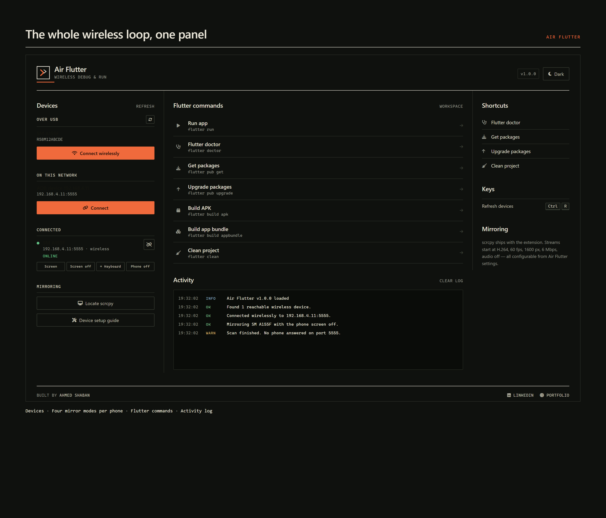
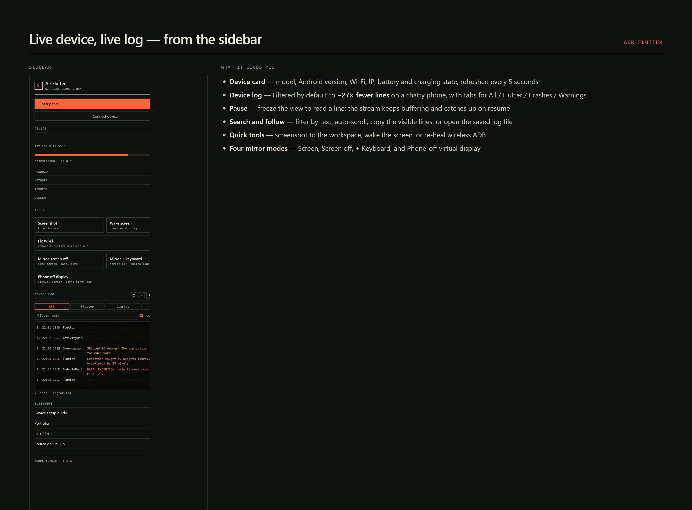
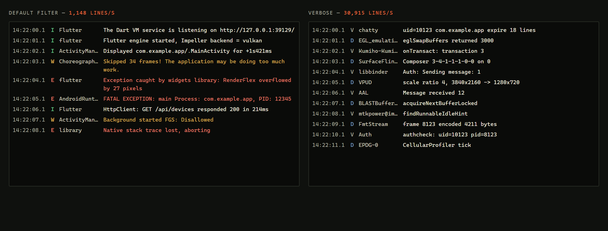

  <h1>Air Flutter</h1>
  
<i>Wireless Flutter debug &amp; screen mirroring for real Android phones</i>

  

    
  

  

    
    
    
  

  

    
    
    
    
  

---

# Air Flutter

**Your phone, on your desktop, without the cable.**

Air Flutter connects an Android phone to your machine over Wi-Fi, mirrors its screen,
streams its log, and runs your everyday Flutter tasks — from one panel, not five terminals.

No pairing codes. No scrcpy setup. No "where is adb again?".

---

## Screenshots

### The whole wireless loop, one panel

### Live device, live log — from the sidebar

### Log filtering, measured on a chatty phone

---

## Why it is different

Most wireless-debug workflows are a pile of shell commands you re-type every time the
phone sleeps. Air Flutter keeps the whole loop in one place, and the interface is built
to be *read*: warm paper and ink, hairline rules, real typographic hierarchy — not
another wall of rounded cards.

- **Zero-config mirroring.** scrcpy ships inside the extension. There is no path to set.
- **No pairing flow.** Plug in once over USB, press one button, unplug. The phone answers
  on the network from then on.
- **Screen-off mirroring.** Keep working on the desktop window while the physical panel
  stays dark — and the phone does not wake when you touch it.
- **A log you can actually read.** Filtered by default to app noise, with Flutter /
  Crashes / Warnings tabs, search, and a Pause that freezes the view without dropping lines.

---

## Features

### Devices

- **Over USB** — detected automatically, one button to enable wireless ADB.
- **On your network** — phones with an open wireless ADB port are discovered for you.
- **Connected** — live status, plus four mirror modes **on each device row**, so there is
  no "pick the device afterwards" step.

### Mirroring

| Mode | What you get |
|---|---|
| **Screen** | The phone screen, as-is, on your desktop |
| **Screen off** | Same screen, physical panel dark |
| **+ Keyboard** | Screen off with a simulated hardware keyboard, so you can switch input languages per keystroke |
| **Phone off** | A virtual display — the phone panel stays off and does not wake on touch |

### Device log

- Streams `adb logcat`, started and stopped on demand.
- Tabs for **All / Flutter / Crashes / Warnings**, a free-text search, and follow-scroll.
- **Pause** freezes the view while lines keep buffering, then catches up on resume.
- Default filter keeps every crash and warning while cutting the vendor chatter — measured
  at **~27× fewer lines** on a Samsung device in debug mode.
- Every line is also appended to `.air-flutter/logcat.log` in your workspace.

### Live device card

Model, serial, Android version and API level, network and Wi-Fi name, IP address, screen
state, and a battery gauge with charging state and temperature — refreshed every 5 seconds.

### Quick tools

- **Screenshot** → saved to `.air-flutter/screenshots/`, then offer to open or reveal it.
- **Wake screen** → turns the display on without unlocking.
- **Fix Wi-Fi** → reboots the phone (with confirmation), waits for it to return, and
  re-establishes wireless ADB.

### Flutter commands

Run app · Flutter doctor · Get packages · Upgrade packages · Build APK · Build app bundle ·
Clean project — plus a live activity log.

---

## Getting started

1. Install the extension and open a Flutter project.
2. Open the **Air Flutter** panel from the Activity Bar.
3. Plug the phone in over USB, enable **USB debugging**, and authorize this computer.
4. Press **Connect wirelessly** on the USB device.
5. Unplug. The phone stays reachable over Wi-Fi.

> The very first wireless connection needs that one USB step — Android requires it once to
> enable TCP/IP mode. After that, reconnecting is a single click.

---

## Settings

| Setting | Default | What it does |
|---|---|---|
| `airFlutter.adbPath` | *(auto)* | Custom ADB executable |
| `airFlutter.flutterPath` | *(auto)* | Custom Flutter executable |
| `airFlutter.scrcpyPath` | *(bundled)* | Custom scrcpy executable |
| `airFlutter.buildMode` | `debug` | Default mode for APK/AAB builds |
| `airFlutter.mirroringMaxSize` | `1600` | Max mirrored dimension; lower means less latency |
| `airFlutter.mirroringMaxFps` | `60` | Max mirroring frame rate |
| `airFlutter.mirroringVideoBitRate` | `6M` | scrcpy video bit rate |
| `airFlutter.mirroringAudio` | `false` | Forward device audio while mirroring |

---

## Troubleshooting

**The phone does not appear on the network.**
Connect over USB once and press **Connect wirelessly**. Wireless ADB stays enabled until
the phone reboots.

**Mirroring fails.**
scrcpy is bundled, so this is almost always an ADB problem. Check that `adb devices`
lists the phone, then try again.

**Arabic or another language types the wrong letters.**
Use **Mirror + Keyboard**. The phone treats your computer keyboard as a physical
keyboard, so language switching happens per keystroke. If the letters are still wrong,
open the phone's *Languages &amp; input → Physical keyboard* settings once and set the
layout. The extension offers a button that opens that page for you.

**The log is overwhelming.**
That is the default *Verbose* being off — it already filters aggressively. If you need
everything, tick **Verbose** in the log panel.

---

## Requirements

- VS Code 1.85.0 or newer (also works in Antigravity IDE and other VS Code forks)
- Flutter SDK on `PATH`
- Android platform-tools (`adb`)
- An Android phone with USB debugging enabled

---

## License

MIT — see [LICENSE](LICENSE).

Built by **[Ahmed Shaban](https://ahmed-shaban-dev.vercel.app)** ·
[LinkedIn](https://www.linkedin.com/in/ahmed-shaban-front-cross)
