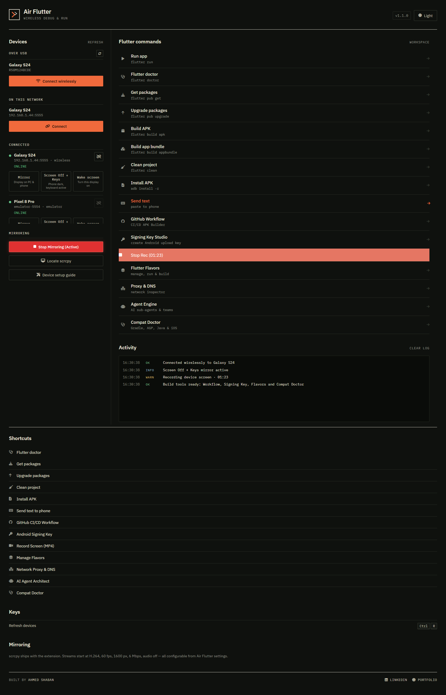
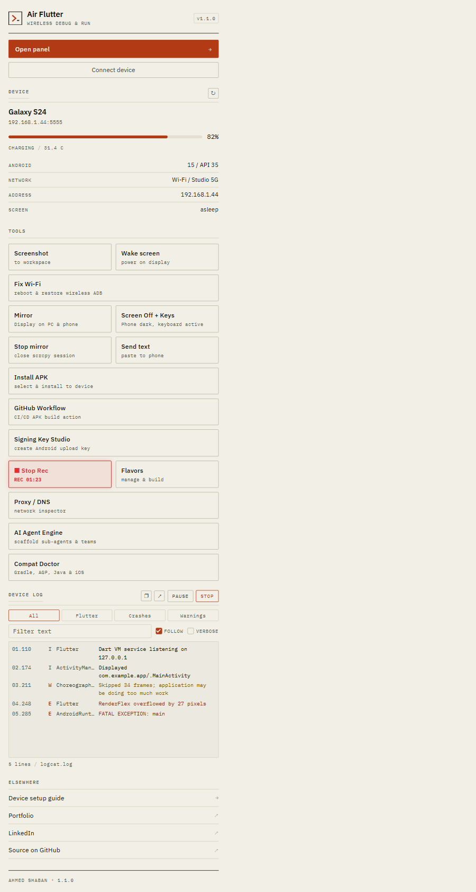
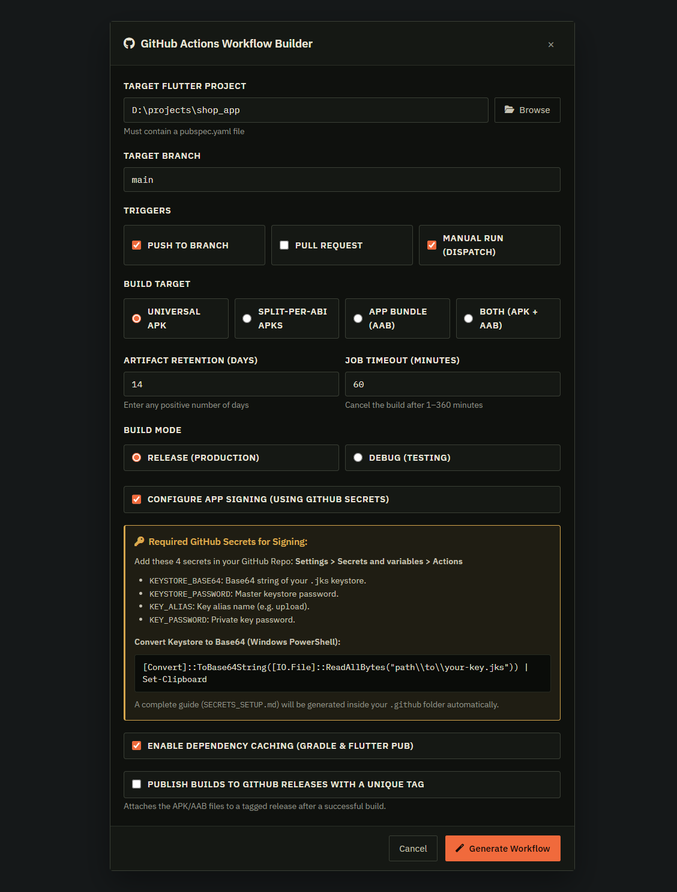
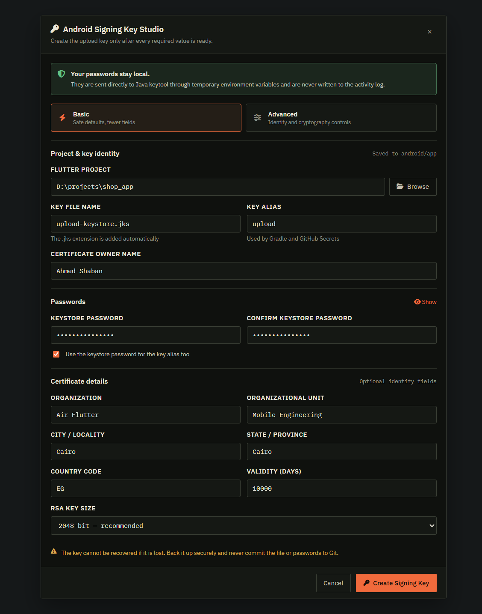
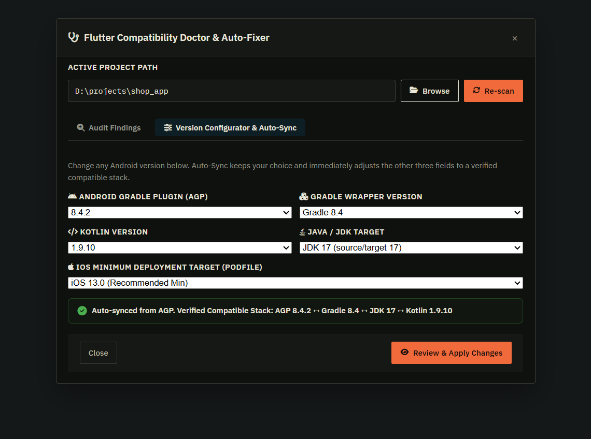
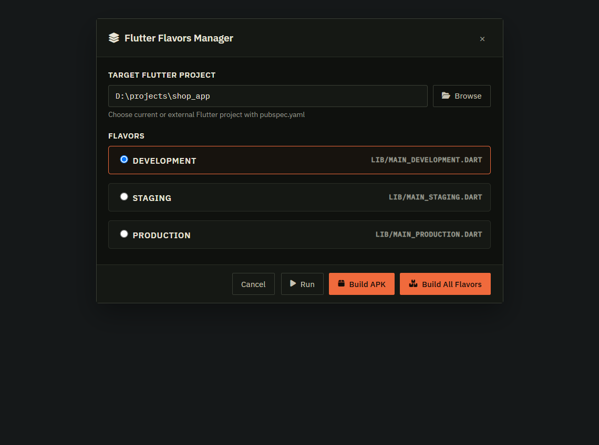
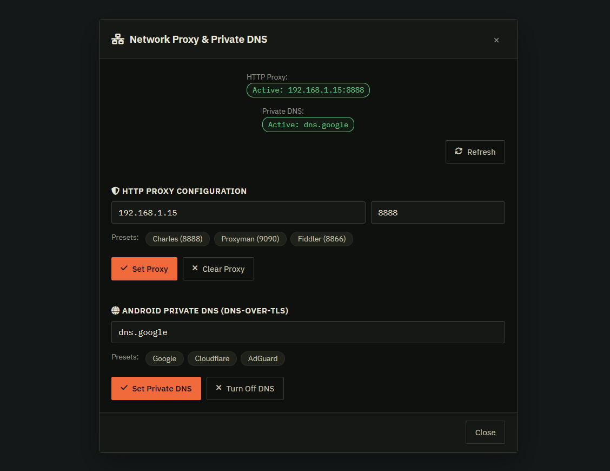
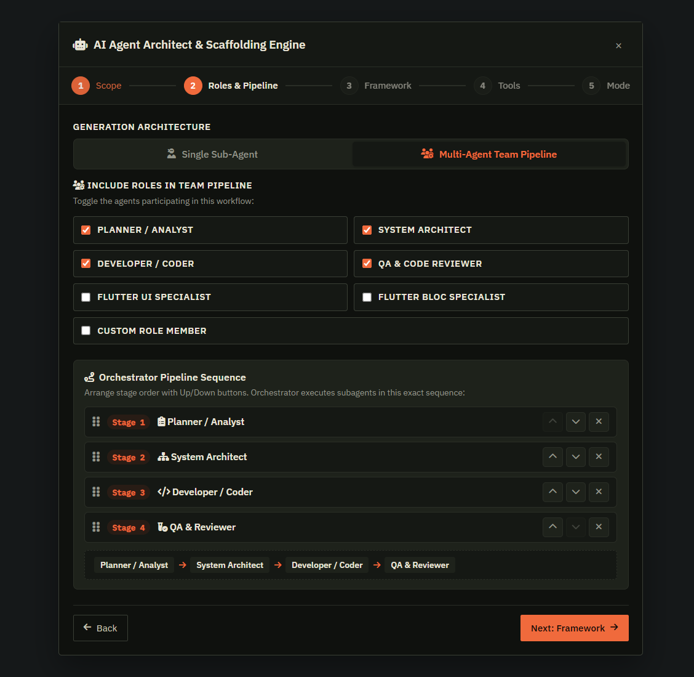
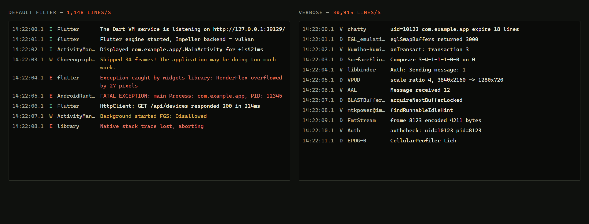

  <h1>Air Flutter</h1>
  
<i>The Complete Wireless Flutter &amp; Android Engineering Suite</i>

  

    
  

  

    
    
    
  

  

    
    
    
    
  

---

# Air Flutter: All-in-One Flutter & Android Powerhouse

**Air Flutter** bridges your physical Android phone and your desktop into a unified, wireless development environment. Connect over Wi-Fi, mirror your display with the screen turned off, record clean MP4 videos for PRs, inspect network traffic through proxies &amp; Private DNS, manage Flutter Flavors, create Android signing keys, scaffold AI Sub-Agents, and automate GitHub Actions CI/CD workflows — all from a single, beautifully designed control panel.

No pairing codes. No terminal acrobatics. No manual adb commands.

---

## Screenshots

### The whole wireless loop &amp; command hub, in one panel

### Live device diagnostics &amp; filtered logcat — right from your sidebar

### GitHub Actions Workflow Builder — CI/CD without writing YAML

### Android Signing Key Studio — upload keys, passwords never logged

### Compatibility Doctor — Version Configurator with four-way auto-sync

### Flutter Flavors Manager — run, build &amp; batch-build every flavor

### Network Proxy &amp; Private DNS in one click

### AI Agent Engine — single sub-agents or full team pipelines

### Aggressive log noise reduction (~27× fewer lines)

---

## Key Features

### 1. 📱 Zero-Friction Wireless ADB
- **One-Click Cable Release**: Plug in once over USB, press **Connect wirelessly**, and unplug. Your phone remains connected over Wi-Fi indefinitely.
- **Auto-Discovery**: Automatically discovers Android devices on your local network with open wireless ADB ports (`5555`).
- **Live Device Health Card**: Monitors battery percentage, charging state, battery temperature, Wi-Fi SSID, IP address, and Android/API versions in real time.

---

### 2. 🖥️ Low-Latency Screen Mirroring (`scrcpy` inside)
- **Zero Configuration**: Bundled with a native, high-performance `scrcpy` build. No paths to configure.
- **Standard Mirror**: Smooth, ultra-low-latency real-time display on your monitor.
- **Screen Off + Hardware Keyboard (Eco Mode)**: Turns the phone's physical display completely dark while keeping it fully operational on your desktop. Your physical keyboard maps directly to the device, enabling instant language switching per keystroke.
- **Instant Termination**: Stop active mirroring sessions with one click from the panel or sidebar, restoring the phone display immediately.

---

### 3. 🚀 GitHub Actions CI/CD Workflow Builder
Automate your Flutter build pipeline without writing YAML by hand:
- **Project Scope Selection**: Target the active workspace or browse to any external Flutter project folder with `pubspec.yaml` validation.
- **Build Targets**: Universal APK, Split-per-ABI APKs, App Bundle (AAB), or Both.
- **Branch Triggers**: Configure Push, Pull Request, and Manual `workflow_dispatch` triggers.
- **Production Keystore Signing**: Full GitHub Secrets configuration for app signing, complete with automatic PowerShell commands to encode your `.jks` file to Base64 and an auto-generated `SECRETS_SETUP.md` guide.
- **Gradle &amp; Pub Caching**: Speed up remote CI build times by caching Gradle packages and Flutter Pub dependencies.
- **Release Publishing**: Optionally attach successful APK/AAB artifacts to a uniquely tagged GitHub Release right after every passing build.
- **Artifact Retention &amp; Job Timeout**: Choose how many days CI artifacts are kept and set a per-job timeout in minutes so stuck runs fail fast instead of burning hours.

---

### 4. 🔑 Android Signing Key Studio
Create the Android upload keystore without opening a terminal:
- **Guided Keystore Wizard**: File name, key alias, certificate identity (owner, organization, city, state, country code), validity in days, and RSA key size (2048/4096) — all in a single form with Basic and Advanced modes.
- **Passwords Stay Local**: Keystore and key passwords flow to Java `keytool` through temporary environment variables and are never written to the activity log.
- **Ready-to-Paste Next Steps**: After creation you get `key.properties` snippets for Groovy and Kotlin DSL, the `android/app/*.jks` `.gitignore` entries, and the PowerShell Base64 command for GitHub Secrets.
- **Pairs with the Workflow Builder**: The generated CI workflow consumes the same alias and GitHub Secrets this studio prepares.

---

### 5. 🍧 Flutter Flavors Suite
Effortlessly manage, configure, run, and batch-build multi-environment Flutter apps:
- **Dialect Detection**: Automatically parses and detects existing `productFlavors` in both Groovy (`android/app/build.gradle`) and Kotlin DSL (`android/app/build.gradle.kts`).
- **Automated Setup Wizard**: Missing flavors? Inject `dev`, `staging`, and `prod` configurations into your build scripts and generate boilerplate entrypoint files (`lib/main_dev.dart`, `lib/main_staging.dart`, `lib/main_prod.dart`) with one click.
- **Run &amp; Build**: Run a specific flavor with its custom entrypoint, build a release APK for a single flavor, or batch-build all project flavors sequentially.

---

### 6. 🎬 Screen Recording for PRs (MP4)
Record silky-smooth demo videos directly from your Android phone for Pull Requests, bug reports, and UX reviews:
- **One-Click Start/Stop**: Record high-bitrate video via ADB `screenrecord`.
- **Live Visual Feedback**: Pulsating animated recording indicator and live timer counter in both the panel and sidebar.
- **Graceful Signal Handling**: Uses graceful interrupt signals to allow Android's `MediaMuxer` to write the MP4 `moov` atom cleanly without file corruption.
- **Instant Access**: Automatically pulls the `.mp4` into your workspace's `screenshots/` directory with a one-click notification to open the video immediately.

---

### 7. 🌐 Network Proxy &amp; Private DNS Inspector
Inspect API requests, debug backend communication, and bypass SSL pinning barriers:
- **LAN IP Detection**: Automatically resolves your host machine's primary local Wi-Fi / Ethernet IPv4 address.
- **HTTP Proxy Presets**: One-click quick presets for popular network inspectors:
  - **Charles Proxy**: Port `8888`
  - **Proxyman**: Port `9090`
  - **Fiddler**: Port `8866`
- **Instant Toggle**: Apply or clear device HTTP proxy settings immediately over ADB without opening Android Settings.
- **Private DNS (DNS-over-TLS)**: Quick presets for **Google** (`dns.google`), **Cloudflare** (`1dot1dot1dot1.cloudflare-dns.com`), **AdGuard** (`dns.adguard-dns.com`), or custom hostnames.

---

### 8. 🤖 AI Agent Architect &amp; Scaffolding Engine
Interactive 5-step visual wizard to design, scaffold, and generate production-ready AI Sub-Agents and Multi-Agent Workflows:
- **Step 1: Scope &amp; Target**: Workspace (`./.agents/agents/`), external project directory (intelligently resolves `<project>/.agents/agents/`), or global machine scope (`~/.gemini/config/agents/` for Antigravity discovery) with safe, non-destructive merging.
- **Step 2: Archetypes &amp; Custom Team Workflow**: Single Sub-Agent or custom Multi-Agent Team Workflows with multi-role selection (Planner, Architect, Developer, QA, Flutter UI, Flutter State, and Custom Roles) with automatic dynamic sequential chaining.
- **Step 3: Framework Compatibility**:
  - **Antigravity Subagents (`<name>.md`)**: Fully compliant with Google Antigravity Subagents specifications with native YAML Frontmatter (`name`, `description`, `model`, `tools`) and asynchronous execution guidance (`invoke_subagent`).
  - **Herdr (`herdr.yaml`)**: Sequential multi-agent pipeline orchestration.
  - **CrewAI (`crew.py`)**: Python crew agents, tasks, and sequential process loops.
  - **Generic Custom Loops**: Standardized agent definitions for autonomous AI loops.
- **Step 4: Tool Permissions Matrix**: Read-Only / Analysis, Standard Engineering, Full Orchestration &amp; Terminal, or Custom tool arrays.
- **Step 5: Content Modes**: **Fully Populated** (high-density system prompts, operational loops, and verification gates) or **Blank Template with Fill Prompts** (skeletal markdown with LLM self-filling prompts).

---

### 9. 🩺 Flutter Compatibility Doctor &amp; Smart Version Configurator
Detect breaking version mismatches, configure custom build stacks, and apply verified auto-fixes:
- **Two-Tab Compatibility Hub** (from the panel or the sidebar, with auto-scan on open):
  - **Audit Findings**: Status cards (Gradle Wrapper, AGP, Java Runtime, iOS Target), real-time diagnostics, and official migration links.
  - **Version Configurator &amp; Auto-Sync**: Pick any AGP, Gradle, Kotlin, Java, or iOS version — change any one of the four Android fields and the other three instantly re-sync around your choice.
- **Four-Way Auto-Sync in Any Direction**: Start from AGP `8.5.2` and land on Gradle `8.7` + Kotlin `1.9.24` + JDK 17, or start from an older Gradle `7.6.4` and get a matching AGP `7.4.2` + Kotlin + JDK 11 stack. The field you edited is always preserved; the other three follow, and the status banner reports the sync source.
- **Full Project Mutation Scope**: Non-destructively updates `gradle-wrapper.properties`, `build.gradle`, `build.gradle.kts`, `settings.gradle`, `settings.gradle.kts`, `ios/Podfile`, and `android/app/build.gradle` (`sourceCompatibility`, `targetCompatibility`, and `jvmTarget`).
- **Diff Preview Modal Before Applying**: Shows a granular before-and-after comparison across all targeted files with selective checkboxes before applying changes.
- **Safe Workspace Edits**: All upgrades apply through `vscode.WorkspaceEdit`, allowing full single-click Undo (`Ctrl+Z`).
- **Dedicated Output Channel**: Generates structured, readable audit reports inside `Air Flutter Compatibility Doctor`.

---

### 10. 📜 High-Performance Device Log (Logcat)
- **Aggressive Noise Filtering**: Filters out noisy vendor and system logs by default, reducing chatter by up to **27×** on heavy devices.
- **Category Tabs**: Switch seamlessly between **All**, **Flutter**, **Crashes**, and **Warnings**.
- **Live Search &amp; Pause**: Search log text on the fly. Freezing the view buffers incoming entries without losing a single line.
- **Automatic Export**: Streams directly to `.air-flutter/logcat.log` in your workspace for easy sharing.

---

### 11. ⚡ Fast Device Actions
- **APK Installer**: Select any `.apk` file from your machine and install it to the device via `adb install -r -d` with a single click.
- **Send Text / Clipboard**: Push computer clipboard content or typed text directly to the active input field on your phone.
- **Wake Screen, Per Phone**: A wake button on every device row turns that specific phone's display on without physical button presses — target the right device in multi-device setups.
- **Fix Wi-Fi**: Reboots device ADB services, re-pairs, and recovers lost wireless ADB connections automatically.

---

### 12. 🧽 Deep Storage &amp; Cache Wiper (Reset App State)
Reset auth tokens, local databases and cache **without uninstalling and reinstalling** the app. Available from both the panel and the sidebar:
- **Auto Package Detection**: Reads `applicationId` from `android/app/build.gradle` or `build.gradle.kts`, or pick from the list of installed third-party packages on the device (`pm list packages -3`).
- **Three Scoped Actions**:
  - **Clear cache** — removes `cache/` only, keeping preferences and databases.
  - **Reset database** — removes `databases/` (SQLite files) only, keeping preferences intact.
  - **Factory reset app** — runs `adb shell pm clear <package>` for a fresh-install state.
- **Graceful Fallback**: Targetted cache/database removal uses `run-as` (works on debug builds) and transparently falls back to `pm clear` with a clear warning when the build is not debuggable — no root required.
- **Guardrails**: The package id is validated, `pm path` confirms it is installed, and system/OEM packages are refused. A modal confirmation always names exactly what will be erased.
- **Auto-restart**: If the app was running before the wipe, it is relaunched to a clean state via its launcher intent.
- **Single-Device Safety**: Every command targets the selected device with `adb -s <serial>`, so other connected phones are never touched.

---

## Getting Started

1. Install **Air Flutter** in VS Code / Antigravity IDE.
2. Open the **Air Flutter** icon in the Activity Bar.
3. Connect your Android phone via USB cable once with **USB Debugging** enabled.
4. Click **Connect wirelessly** next to your USB device.
5. Unplug the cable! Your device will remain connected and accessible over Wi-Fi.

> **Tip:** You only need the USB cable once to initialize TCP/IP mode on the device. Once enabled, you can reconnect wirelessly anytime as long as the phone has not rebooted.

---

## Extension Settings

| Setting | Default | Description |
|---|---|---|
| `airFlutter.adbPath` | `""` *(auto)* | Custom path to the ADB executable if not on system PATH |
| `airFlutter.flutterPath` | `""` *(auto)* | Custom path to the Flutter executable |
| `airFlutter.scrcpyPath` | `""` *(bundled)* | Custom path to an external scrcpy executable |
| `airFlutter.defaultBuildMode` | `debug` | Default build mode for APK/AAB compilation (`debug`, `profile`, `release`) |
| `airFlutter.mirroringMaxSize` | `1600` | Maximum mirrored dimension; lower values decrease wireless latency |
| `airFlutter.mirroringMaxFps` | `60` | Maximum screen mirroring frame rate (15–120 FPS) |
| `airFlutter.mirroringVideoBitRate` | `6M` | Video bitrate for screen mirroring (e.g. `4M`, `8M`) |
| `airFlutter.mirroringAudio` | `false` | Forward device audio while mirroring |

---

## System Requirements

- **VS Code**: Version `1.85.0` or newer (or Google Antigravity IDE, Cursor, VSCodium)
- **Flutter SDK**: Installed and available on system `PATH`
- **Android Platform Tools**: `adb` installed (bundled or on system `PATH`)
- **Android Device**: Android 5.0+ with **Developer Options** and **USB Debugging** enabled

---

## License

MIT © [Ahmed Shaban](https://ahmed-shaban-dev.vercel.app)

Crafted with care by **Ahmed Shaban** · [LinkedIn](https://www.linkedin.com/in/ahmed-shaban-front-cross) · [Portfolio](https://ahmed-shaban-dev.vercel.app) · [GitHub](https://github.com/ahmedshaban-blip)
